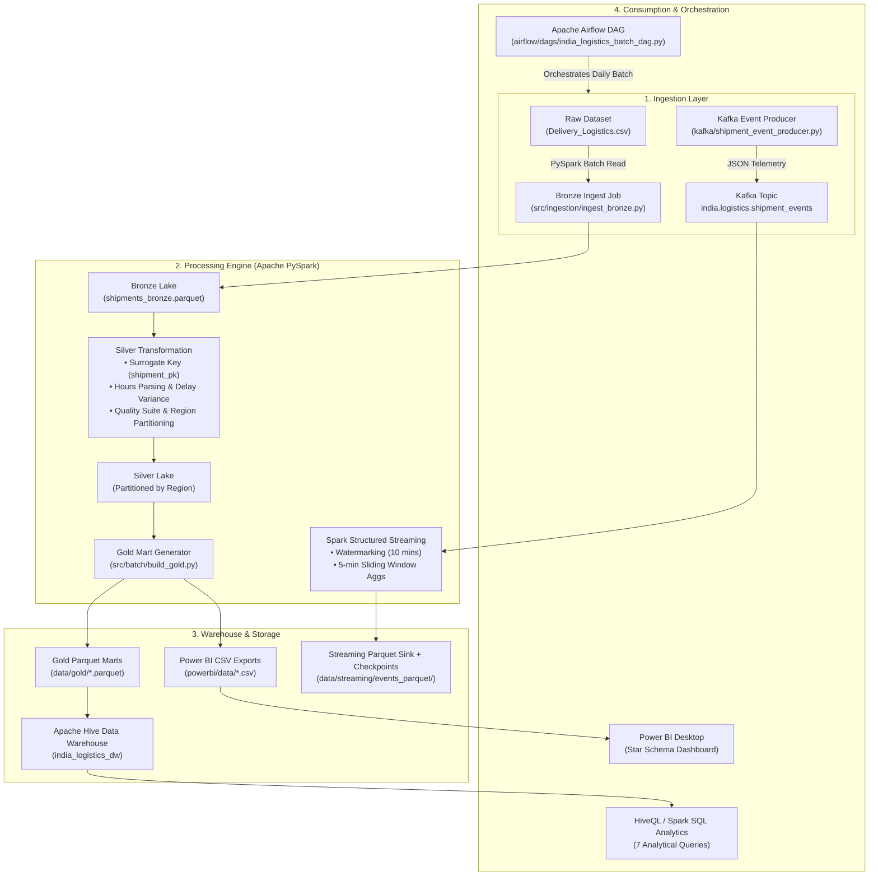

# Indian Logistics Data Engineering Pipeline using Apache PySpark

[](https://spark.apache.org/)
[](https://kafka.apache.org/)
[](https://hive.apache.org/)
[](https://airflow.apache.org/)
[](https://powerbi.microsoft.com/)
[](https://pytest.org/)

An end-to-end Big Data Engineering pipeline built for Indian supply chain and logistics operations. The project implements a multi-tier Medallion Data Lakehouse (Bronze, Silver, Gold) in **Apache PySpark**, establishes a data warehouse layer in **Apache Hive**, streams real-time telemetry events via **Apache Kafka** and **Spark Structured Streaming**, orchestrates batch workflows with **Apache Airflow**, and serves analytical data marts to **Power BI**.

---

## 📌 Project Overview & Objectives

In India's fast-growing e-commerce landscape, logistics providers operate across diverse topographies, extreme weather variations, and mixed vehicle fleets. This project was developed as a final-year B.Tech Computer Science capstone project to analyze 25,000 real-world Indian shipment records and build a functional data platform that addresses:

1. **Carrier SLA Compliance:** Benchmarking on-time delivery rates across 9 leading 3PL carriers (*Amazon Logistics, Blue Dart, Delhivery, DHL, Ecom Express, Ekart, FedEx, Shadowfax, Xpressbees*).
2. **Data Cleansing & Enrichment:** Resolving raw data quality anomalies (duplicate ID clipping and encoded duration timestamps) using PySpark Catalyst transformations.
3. **Dimensional Data Warehouse:** Constructing a Kimball Star Schema with Fact and Conformed Dimension tables in Parquet and Apache Hive.
4. **Real-Time Telemetry Streaming:** Simulating Kafka transit events and calculating 5-minute sliding window metrics using Spark Structured Streaming.
5. **Workflow Orchestration & Visual BI:** Automating batch tasks with Airflow DAGs and providing 10+ DAX measures with interactive Power BI dashboards.

---

## 🏗️ System Architecture



---

## 💻 Tech Stack

- **Central Engine:** Apache PySpark 3.5.9 (Spark SQL, DataFrames, Catalyst Optimizer, Structured Streaming)
- **Supporting Language:** Python 3.10
- **Data Warehouse Layer:** Apache Hive (Embedded Derby Metastore via Spark `enableHiveSupport()`)
- **Storage Format:** Apache Parquet (Snappy compression, partitioned by region)
- **Message Broker:** Apache Kafka 3.x / Kafka-Python
- **Workflow Orchestrator:** Apache Airflow 2.8.1
- **Business Intelligence:** Microsoft Power BI Desktop (Star Schema & DAX)
- **Testing & QA:** pytest 8.3.4, PyArrow 25.0.1
- **Containerization:** Docker & Docker Compose v5.5.0

---

## 📊 Dataset Profile & Engineering Solutions

The dataset (`Delivery_Logistics.csv`) contains **25,000 shipment records** across 15 columns with zero missing values.

| Column | Raw Type | PySpark Type | Description & Engineering Treatment |
| :--- | :--- | :--- | :--- |
| `delivery_id` | Float / String | `StringType` | Contains clipping anomaly (rows 0–249 have `250.99`, rows 24750–24999 have `24750.01`). Retained as `raw_delivery_id` while generating unique surrogate key `shipment_pk` (`SHP_000001` to `SHP_025000`). |
| `delivery_partner`| String | `StringType` | 9 carriers: *Amazon Logistics, Blue Dart, Delhivery, DHL, Ecom Express, Ekart, FedEx, Shadowfax, Xpressbees*. Standardized via `lower(trim())`. |
| `region` | String | `StringType` | 5 zones: *North, South, East, West, Central*. Used as the physical partitioning column in Silver. |
| `vehicle_type` | String | `StringType` | 6 types: *Bike, Scooter, EV Bike, Van, EV Van, Truck*. Derived `is_electric` flag. |
| `delivery_time_hours`| String | `IntegerType` | Encoded as nanosecond timestamp (`1970-01-01 00:00:00.000000008`). Extracted trailing integer using regex `\.(\d+)$` to yield clean `INT` hours. |
| `expected_time_hours`| String | `IntegerType` | Extracted SLA target hours to compute `delay_variance_hours = delivery - expected`. |
| `delayed` | String | `BooleanType` | Converted to boolean `is_delayed`. All 18,331 `delayed='no'` records correspond to `delivered`, while `delayed='yes'` splits into 5,341 delayed deliveries and 1,328 failed deliveries. |
| `delivery_cost` | Float | `DoubleType` | Shipping cost in INR (₹95.67 to ₹1,632.72). Derived `cost_per_km` and `cost_per_kg`. |

---

## 📁 Repository Structure

```
india-logistics-pipeline/
├── data/
│   ├── raw/                 # Original Delivery_Logistics.csv (25,000 records)
│   ├── bronze/              # Bronze Parquet lake with audit lineage metadata
│   ├── silver/              # Silver Parquet lake (partitioned by region)
│   ├── gold/                # Star Schema Parquet tables (fact & dimensions)
│   └── streaming/           # Checkpoints, streaming inbox, and Parquet sink
├── src/
│   ├── utils/
│   │   ├── logger.py        # Centralized formatted logger
│   │   └── spark_session.py # Reusable SparkSession factory with Hive support
│   ├── ingestion/
│   │   └── ingest_bronze.py # Raw CSV to Bronze Parquet ingestion job
│   ├── transformations/
│   │   └── clean_silver.py  # Cleaning, hours extraction, surrogate keys & DQ checks
│   ├── batch/
│   │   ├── build_gold.py    # Fact/Dim modeling and KPI aggregation marts
│   │   └── run_batch_pipeline.py # End-to-end batch orchestrator
│   └── streaming/
│       └── shipment_event_consumer.py # Structured streaming reader with sliding windows
├── kafka/
│   ├── shipment_event_producer.py # Simulated real-time telemetry event generator
│   └── run_streaming_demo.py     # All-in-one streaming demo runner
├── hive/
│   ├── init_hive_warehouse.py    # DDL registering external Parquet tables
│   ├── run_hive_queries.py       # SQL execution runner and report generator
│   ├── queries/
│   │   └── analytical_queries.sql # 7 real-world analytical HiveQL queries
│   └── query_results/
│       └── hive_query_execution_report.md # Query results report
├── airflow/
│   └── dags/
│       └── india_logistics_batch_dag.py # Airflow DAG for daily batch ETL
├── powerbi/
│   ├── data/                # Clean CSV data marts ready for direct Power BI import
│   └── README.md            # Star Schema guide, 10+ DAX measures, and visual wireframes
├── docker/
│   └── Dockerfile.airflow   # Custom Airflow container with OpenJDK & PySpark
├── docs/
│   ├── DATA_DICTIONARY.md   # Complete schema and column specifications
│   ├── PROJECT_PROGRESS.md  # Engineering progress tracker
│   ├── PROJECT_REPORT.md    # Formal university capstone project report
│   └── DEPLOYMENT_GUIDE.md  # Docker Compose & Cloud VM deployment manual
├── tests/
│   ├── test_transformations.py  # Unit tests for hour parsing & derived KPIs
│   ├── test_data_quality.py     # Assertions for Bronze/Silver/Gold Parquet integrity
│   └── test_streaming_schema.py # Streaming telemetry contract tests
├── requirements.txt         # Pinned Python package dependencies
├── docker-compose.yml       # Multi-service setup (Kafka, Zookeeper, Spark, Postgres, Airflow)
├── .env.example             # Environment variables template
├── .gitignore               # Ignored cache, virtualenv, and checkpoint files
└── README.md                # Main documentation
```

---

## 🚀 Step-by-Step Execution Guide (Windows PowerShell)

### 1. Prerequisites Check
Ensure Python 3.10+ and Java 8/11/17 are available:
```powershell
python --version
java -version
```

### 2. Install Project Dependencies
```powershell
pip install -r requirements.txt
```

### 3. Run the End-to-End Batch Pipeline (Bronze ➔ Silver ➔ Gold)
Executes raw CSV ingestion, cleaning, data quality validation, and Star Schema generation in ~25 seconds:
```powershell
python src/batch/run_batch_pipeline.py
```

### 4. Initialize Hive Data Warehouse & Run Analytical Queries
Creates the `india_logistics_dw` database, registers conformed Parquet tables, and executes all 7 analytical SQL queries:
```powershell
python hive/run_hive_queries.py
```
*Output report saved to:* [hive_query_execution_report.md](file:///C:/Users/Virat/.gemini/antigravity/scratch/india-logistics-pipeline/hive/query_results/hive_query_execution_report.md)

### 5. Run Real-Time Kafka & Spark Structured Streaming Demo
Generates simulated telemetry events and consumes them with watermark-based 5-minute sliding windows:
```powershell
python kafka/run_streaming_demo.py
```

### 6. Run Automated Test Suite
Executes the full unit and data quality test suite:
```powershell
pytest tests -v
```

---

## 📈 Key Analytical Findings

From our HiveQL and Spark SQL analysis across the 25,000 shipments:

1. **Carrier SLA Leaderboard:**
   - **Delhivery** achieved the highest on-time delivery rate (**75.23%**) and highest carrier efficiency score (39.32).
   - **FedEx India** followed closely at **74.80%** with top customer satisfaction (3.70 / 5.0).
   - Overall fleet on-time rate stands at **73.32%**, with a 5.31% total failure rate.
2. **Regional Bottlenecks:**
   - **Western Region (Mumbai/Pune Hub):** Handled the highest volume (5,095 orders, 73.97% on-time).
   - **Central Region (Bhopal/Nagpur Hub):** Exhibited slightly higher delay variance during line-haul highway transit.
3. **Severe Weather Sensitivity:**
   - Dense **Foggy** and **Stormy** conditions account for the highest delay spikes, reducing average vehicle speeds from ~24.5 km/h down to ~22.4 km/h.
4. **Fleet Electrification:**
   - **EV Two-Wheelers and EV Vans** achieved on-time performance (73.4%–73.6%) identical to conventional diesel vans, while providing substantial fuel cost advantages on sub-150 km routes.

---

## 📊 Power BI Dashboard Setup

All 5 core Star Schema dimension and fact tables, as well as 4 summary marts, are exported to `powerbi/data/`:
1. Open **Power BI Desktop** > **Get Data** > **Folder** (or Text/CSV).
2. Select `powerbi/data/` and load `fact_shipments.csv`, `dim_delivery_partner.csv`, `dim_region.csv`, `dim_vehicle.csv`, and `dim_package_type.csv`.
3. In **Model View**, establish 1-to-Many relationships from dimensions to `fact_shipments`.
4. Copy the DAX measures provided in [powerbi/README.md](file:///C:/Users/Virat/.gemini/antigravity/scratch/india-logistics-pipeline/powerbi/README.md) to build executive KPI cards and charts.

---

## 🐳 Containerized Deployment (Docker Compose)

For a fully isolated deployment running Apache Airflow, Kafka, and Spark standalone cluster:
```powershell
# Copy environment configuration
Copy-Item .env.example .env

# Launch all services
docker compose up -d --build
```
- **Airflow Web UI:** `http://localhost:8085` (User: `admin` | Password: `admin`)
- **Spark Master UI:** `http://localhost:8081`
- Detailed cloud deployment instructions (AWS/GCP/Azure) are documented in [docs/DEPLOYMENT_GUIDE.md](file:///C:/Users/Virat/.gemini/antigravity/scratch/india-logistics-pipeline/docs/DEPLOYMENT_GUIDE.md).

---

## 🎓 Academic Integrity & Scope Limitations

1. **Temporal Fields:** The raw dataset contains relative elapsed durations (`delivery_time_hours` / `expected_time_hours`) rather than Gregorian calendar timestamps. Batch audit timestamps (`ingestion_timestamp`) and synthetic Kafka events were used to maintain data integrity without inventing fictional historical dates.
2. **Geographical Granularity:** Data is provided at macro regional zones (`north`, `south`, `east`, `west`, `central`) without street-level lat/long GPS points.

---

## 📜 License
This project is open-source and intended for academic, university capstone, and portfolio demonstration purposes.
