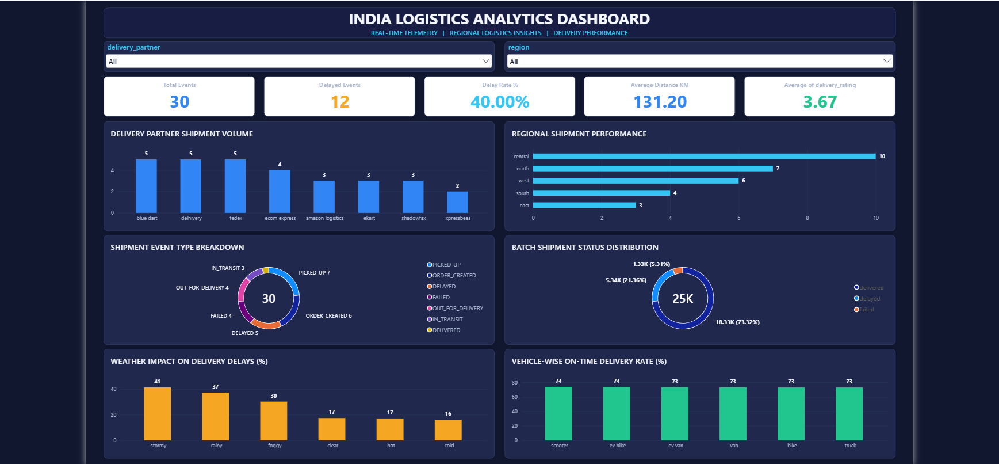
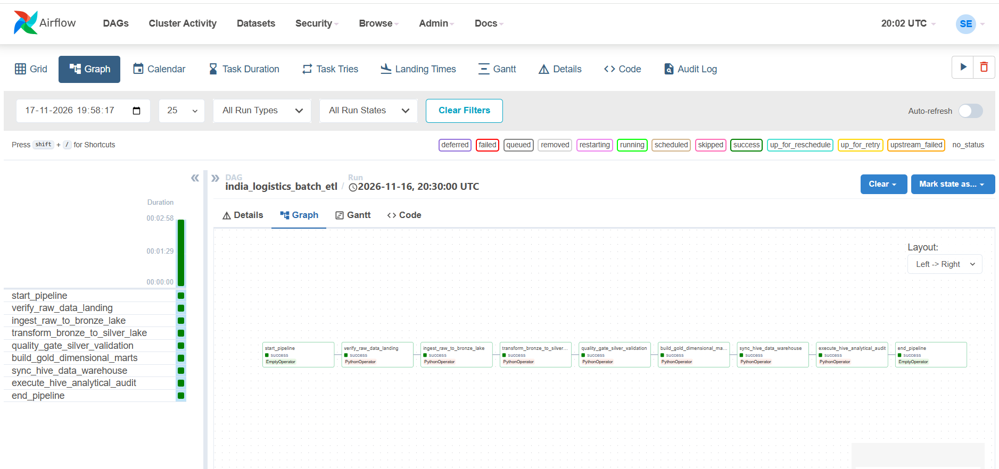
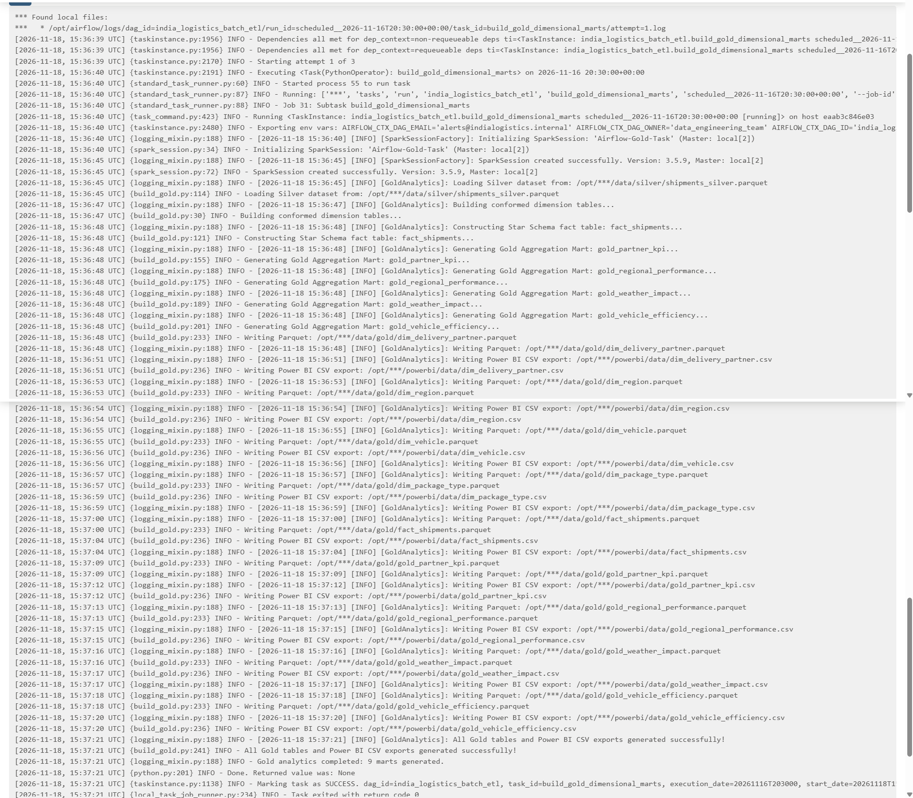

# Indian Logistics Data Engineering Pipeline

I built this project to explore how a data engineering pipeline can transform raw logistics data into structured datasets that are useful for analysis and decision-making.

The project uses shipment data from India and processes it through multiple stages using PySpark. It combines batch processing, simulated real-time event ingestion, data modeling, SQL analytics and workflow orchestration. The final analytical outputs are connected to a Power BI dashboard.

The goal was to understand how different data engineering components work together, from raw data ingestion to reporting.

## What Does This Project Do?

The pipeline processes a logistics dataset containing **25,000 shipment records and 15 columns**.

It follows a Medallion Architecture with three layers:

- **Bronze:** Loads raw CSV data and stores it in Parquet format.
- **Silver:** Cleans, standardizes and validates the data, while creating additional fields required for analysis.
- **Gold:** Creates fact and dimension tables along with aggregated datasets for reporting.

Alongside batch processing, I implemented a Kafka-based streaming component that generates simulated shipment events and processes them using Spark Structured Streaming.

### Overall Architecture

```text
                   Raw Logistics CSV
                    25,000 Records
                          |
                          v
                   PySpark Ingestion
                          |
                          v
                   BRONZE LAYER
                 Raw Data in Parquet
                          |
                          v
                  SILVER LAYER
             Cleaning and Transformation
               Data Quality Validation
                          |
                          v
                    GOLD LAYER
               Fact and Dimension Tables
                Analytical Data Marts
                          |
              +-----------+-----------+
              |                       |
              v                       v
         Hive Analytics           Power BI
           SQL Queries            Dashboard


  Kafka Event Producer
           |
           v
      Kafka Topic
           |
           v
  Spark Structured Streaming
           |
           v
    Microbatch Processing
           |
           v
    Parquet Output and
       Checkpoints


        Apache Airflow
        Orchestrates the
         Batch Workflow
```

## Technologies Used

| Technology | Purpose |
|---|---|
| Python | Pipeline development and supporting scripts |
| Apache PySpark | Data ingestion, cleaning and transformation |
| Apache Kafka | Shipment event generation and ingestion |
| Spark Structured Streaming | Microbatch stream processing |
| Apache Hive | SQL analytics using Spark Hive support |
| Apache Airflow | Batch workflow orchestration |
| Docker & Docker Compose | Running the supporting services |
| PostgreSQL | Airflow metadata database |
| Power BI | Interactive data visualization |
| Pytest | Pipeline testing |
| Parquet | Storage format for processed datasets |

## How the Pipeline Works

### 1. Raw Data Ingestion – Bronze Layer

The pipeline begins with a CSV dataset containing 25,000 shipment records and 15 columns.

PySpark reads the raw data and stores it in Parquet format in the Bronze layer.

This layer preserves the ingested data in a structured storage format and provides the starting point for subsequent transformations.

**Output:** Raw shipment data stored as Parquet files.

### 2. Data Cleaning and Transformation – Silver Layer

The Bronze data is processed using PySpark.

In this stage, I worked on:

- Handling missing and inconsistent values.
- Standardizing data fields.
- Processing delivery-duration information.
- Creating derived fields for analytical use.
- Applying data-quality checks.
- Organizing the processed data by region.

The objective is to make the data consistent and suitable for downstream analysis.

**Output:** Cleaned and transformed shipment data stored in the Silver layer.

### 3. Data Modeling – Gold Layer

After cleaning, the Silver data is used to build the Gold layer.

I designed the analytical model using a star-schema approach.

**Fact table**

- `fact_shipments`

**Dimension tables**

- `dim_delivery_partner`
- `dim_region`
- `dim_vehicle`
- `dim_package_type`

In addition to these five dimensional-model tables, I generated four analytical tables:

- Delivery partner KPIs
- Regional performance
- Weather impact
- Vehicle efficiency

This gives a total of **9 Gold tables**.

These tables provide structured data for SQL analysis and Power BI reporting.

**Output:** 9 Gold tables consisting of one fact table, four dimension tables and four analytical tables.

### 4. Real-Time Event Processing – Kafka and Spark Streaming

Apart from the batch pipeline, I implemented a separate streaming component to understand how incoming shipment events can be processed.

The workflow is:

1. A Python producer generates simulated shipment events.
2. The events are published to a Kafka topic named `india.logistics.shipment_events`.
3. Spark Structured Streaming consumes the events.
4. Incoming records are processed in microbatches.
5. Processed data is written to Parquet output.
6. Checkpointing is configured to maintain streaming progress.

The events are simulated rather than obtained from a live logistics platform.

### 5. SQL Analytics – Hive

I integrated Spark with Hive support and registered the Gold tables in the `india_logistics_dw` database.

I wrote and executed seven analytical SQL queries to examine different aspects of logistics performance.

The queries cover:

- Overall shipment performance and delivery KPIs.
- Delivery partner reliability and SLA compliance.
- Regional bottlenecks and delivery delays.
- Weather impact on delivery performance.
- Electric versus conventional vehicle efficiency.
- Regional partner rankings using window functions.
- Package category delivery risk.

**Execution summary:**

- Analytical queries executed: 7
- Shipments analyzed: 25,000
- Database: `india_logistics_dw`

The detailed SQL queries and execution results are available in the [Hive Query Execution Report](hive/query_results/hive_query_execution_report.md).

### 6. Workflow Orchestration – Apache Airflow

I created an Airflow DAG named `india_logistics_batch_etl` to orchestrate the batch pipeline.

The DAG contains **9 dependent tasks**:

1. Start pipeline.
2. Verify raw data availability.
3. Ingest raw data into Bronze.
4. Transform Bronze into Silver.
5. Run Silver data-quality validation.
6. Build Gold dimensional tables and analytical marts.
7. Synchronize the Hive data warehouse.
8. Execute Hive analytical queries.
9. End pipeline.

I configured task dependencies and retries to manage the execution flow.

The DAG is scheduled to run daily at 2:00 AM in the Asia/Kolkata timezone.

**Execution detail:** The Airflow tasks currently execute Spark locally using `local[2]`. This is a local execution setup rather than a distributed Spark cluster.

### 7. Power BI Dashboard

The Gold-layer analytical outputs are exported as CSV datasets and connected to Power BI.

I built an interactive dashboard to explore shipment performance from different perspectives.

The dashboard includes:

- Total shipment records.
- Delayed shipments and delay rate.
- Average delivery distance.
- Average delivery rating.
- Delivery partner performance.
- Regional performance.
- Weather impact on delivery delays.
- Vehicle-wise on-time delivery performance.

The dashboard makes it easier to explore the results without manually running SQL queries.

## Execution Results

I successfully executed the batch pipeline and verified the output tables and analytical results.

### Dataset and Output Summary

| Item | Result |
|---|---:|
| Source dataset | 1 CSV file |
| Source records | 25,000 |
| Source columns | 15 |
| Gold fact tables | 1 |
| Gold dimension tables | 4 |
| Gold analytical tables | 4 |
| Total Gold tables | 9 |
| Hive analytical queries | 7 |

### Logistics Performance Results

| Metric | Result |
|---|---:|
| Total shipments analyzed | 25,000 |
| On-time delivery rate | 73.32% |
| Failed delivery rate | 5.31% |
| Average delivery duration | 6.25 hours |
| Average delivery cost | ₹864.94 |
| Average customer satisfaction | 3.67 |

### Pipeline Execution Time

I recorded the following execution times during successful runs:

| Execution | Recorded time |
|---|---:|
| Direct batch pipeline execution | Approximately 28.8 seconds |
| Complete Airflow DAG execution | Approximately 2 minutes 58 seconds |
| Individual Hive query execution | Approximately 0.38–3.06 seconds |

The direct batch execution and Airflow execution follow different execution paths. Airflow includes orchestration overhead and individual task execution, so its total runtime is longer.

The seven reported Hive query execution times add up to approximately 8.44 seconds.

These are observed execution results from my local environment, not fixed performance benchmarks. Actual timings may vary depending on the machine and Docker resources.

## Project Structure

```text
india-logistics-data-engineering-pipeline/
│
├── airflow/
│   └── dags/
│
├── config/
├── data/
│   └── raw/
│
├── docker/
│
├── docs/
│
├── hive/
│   ├── queries/
│   └── query_results/
│
├── kafka/
│
├── powerbi/
│   └── data/
│
├── screenshots/
│
├── src/
│   ├── batch/
│   ├── ingestion/
│   ├── streaming/
│   ├── transformations/
│   └── utils/
│
├── tests/
│
├── docker-compose.yml
├── requirements.txt
└── README.md
```

## Running the Project

### Requirements

- Python 3.10
- Java 17
- Docker Desktop
- Power BI Desktop (to view the dashboard)

### 1. Clone the Repository

```bash
git clone https://github.com/Virat213/india-logistics-data-engineering-pipeline.git

cd india-logistics-data-engineering-pipeline
```

### 2. Create a Virtual Environment

```powershell
python -m venv .venv
.venv\Scripts\Activate.ps1
```

### 3. Install Dependencies

```bash
pip install -r requirements.txt
```

### 4. Add the Source Dataset

Place the source CSV file at:

```text
data/raw/Delivery_Logistics.csv
```

The raw source dataset is not included in the repository.

### 5. Run the Batch Pipeline

```bash
python -m src.batch.run_batch_pipeline
```

### 6. Start Docker Services

Create your local environment file:

```powershell
Copy-Item .env.example .env
```

Update the credentials in `.env`, then start the services:

```bash
docker compose up -d --build
```

Airflow is available at:

`http://localhost:8085`

For additional setup instructions, refer to the [Deployment Guide](docs/DEPLOYMENT_GUIDE.md).

## Screenshots and Execution Evidence

### 1. Power BI Dashboard

The dashboard provides an overview of shipment performance, delivery trends, regional analysis and vehicle efficiency.



[View Full Dashboard Screenshot](screenshots/logistics-dashboard.png)

### 2. Airflow Pipeline Execution

The screenshot shows the successful execution of all nine tasks in the batch ETL workflow through Airflow.



[View Full Airflow Execution Screenshot](screenshots/airflow-dag-success.png)

### 3. PySpark Gold Layer Execution

The execution logs show the Gold-layer processing using Apache Spark 3.5.9, including fact and dimension table creation, analytical mart generation and Power BI CSV exports.



[View Full PySpark Execution Screenshot](screenshots/pyspark-gold-execution.png)

## Current Limitations

- The streaming component uses simulated shipment events rather than a live logistics API.
- Airflow orchestrates the batch workflow using local Spark execution (`local[2]`).
- Hive integration uses Spark's embedded Hive support.
- The raw source dataset and generated Parquet files are not included in the repository.
- The project currently uses a local Docker-based setup rather than a cloud deployment.

## Future Improvements

Some areas I would like to explore next:

- Incremental data processing.
- Event-time windowed streaming analytics.
- Improved pipeline monitoring and alerting.
- Automated testing through GitHub Actions.
- Cloud deployment.

## Developed By

**Virat**

[GitHub Repository](https://github.com/Virat213/india-logistics-data-engineering-pipeline)