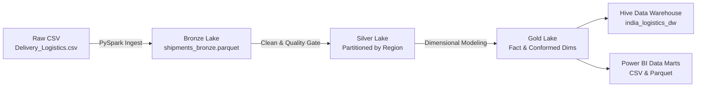
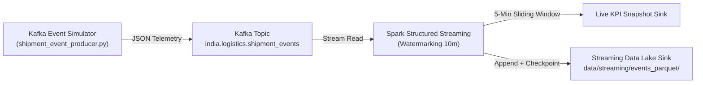

# Project Report: Indian Logistics Data Engineering Pipeline using Apache PySpark

**Degree:** Bachelor of Technology (B.Tech) in Computer Science & Engineering  
**Subject:** Final Year Capstone Project / Advanced Data Engineering  
**Project Title:** End-to-End Indian Logistics Data Pipeline & Real-Time Telemetry Analytics  
**Repository:** `india-logistics-pipeline`  
**Date:** November 2026  

---

## Abstract
The rapid expansion of the Indian e-commerce and third-party logistics (3PL) sector has generated massive volumes of operational shipment data. However, logistics operators struggle with delayed deliveries, severe weather bottlenecks across distinct geographic zones, vehicle fleet inefficiencies, and carrier performance variances. 

This project designs and implements an end-to-end, multi-tier big data engineering pipeline using **Apache PySpark**, **Apache Hive**, **Apache Kafka**, **Apache Airflow**, and **Power BI**. The system processes a 25,000-record Indian logistics dataset encompassing 9 major carriers (*Amazon Logistics, Blue Dart, Delhivery, DHL, Ecom Express, Ekart, FedEx, Shadowfax, Xpressbees*) across five macro-regions of India. 

A Medallion Data Lakehouse architecture (Bronze, Silver, Gold) was implemented in PySpark to clean raw ingestion data, parse encoded temporal duration formats, resolve surrogate primary keys, and compute operational KPIs. The analytics layer was integrated into an Apache Hive data warehouse and Power BI dashboard utilizing a Kimball Star Schema model. Additionally, a real-time event generator and Spark Structured Streaming pipeline with watermark-based sliding windows was built to handle simulated live shipment status transitions. Automated unit testing with `pytest` and containerized deployment with `docker-compose` ensure reproducibility and academic engineering rigor.

---

## 1. Introduction & Problem Statement

### 1.1 Background
The Indian logistics market is unique due to its immense geographical diversity, high reliance on multimodal transport (ranging from electric two-wheelers for hyperlocal delivery to heavy line-haul trucks), and severe environmental variations (monsoon floods, dense northern winter fog, and summer heatwaves).

Key industry challenges include:
1. **SLA Violations & Delays:** Managing customer expectations regarding same-day and express delivery commitments.
2. **Carrier Allocation:** Lack of transparent performance metrics comparing national 3PLs against captive delivery arms.
3. **Green Fleet Transition:** Quantifying the operational cost-per-kilometer savings of electric vehicles (EV bikes, EV vans) versus internal combustion engine (ICE) vehicles.
4. **Data Fragmentation:** Unifying real-time tracking streams with historical batch performance marts.

### 1.2 Objectives
- Build a robust, scalable batch ETL pipeline using Apache PySpark to ingest, clean, validate, and enrich logistics data.
- Design a Kimball-style Star Schema with dimension tables and fact tables.
- Establish an Apache Hive external data warehouse layer over Parquet files to execute complex analytical queries.
- Build a Kafka event simulator and Spark Structured Streaming consumer with windowed aggregations and checkpointing.
- Orchestrate batch workflows using an Apache Airflow DAG with quality gates.
- Deliver executive and operational business intelligence dashboards in Power BI.

---

## 2. Technology Stack & Architectural Decision Rationale

| Layer | Technology | Decision Rationale |
| :--- | :--- | :--- |
| **Data Processing Engine** | **Apache PySpark 3.5.9** | Distributed in-memory data processing, Catalyst Optimizer, rich DataFrame API, Spark SQL, and native Structured Streaming support. Avoided pure Pandas to support scalability. |
| **Storage Format** | **Apache Parquet** | Columnar storage, high compression ratio (Snappy), predicate pushdown, and partition pruning on disk. |
| **Data Warehouse Layer** | **Apache Hive (via Spark SQL)** | Embedded Derby Metastore integration enabling HiveQL DDL/DML over external Parquet tables without requiring heavy HDFS infrastructure. |
| **Real-Time Streaming** | **Apache Kafka & Structured Streaming** | Decoupled event ingestion bus paired with Spark's micro-batch streaming engine with watermarking and checkpointing. |
| **Orchestration** | **Apache Airflow 2.8.1** | Industry-standard DAG scheduler providing programmatic task dependencies, retries, and data quality validation gates. |
| **Business Intelligence** | **Power BI Desktop** | Star schema relationship modeling, DAX measure creation, interactive filtering, and executive reporting. |
| **Containerization** | **Docker & Docker Compose** | Isolated local multi-service container orchestration ensuring cross-platform reproducibility. |

---

## 3. Data Architecture: Medallion Lakehouse & Star Schema

### 3.1 Bronze Layer (Raw Ingestion)
- **Path:** `data/bronze/shipments_bronze.parquet`
- **Logic:** Ingests raw data with schema inference.
- **Audit Lineage:** Injects `ingestion_timestamp`, `source_file`, `batch_id` (UUID), and `record_status` (`RAW_INGESTED`). Preserves raw data fidelity without mutation.

### 3.2 Silver Layer (Cleaning, Quality Checks & Enrichment)
- **Path:** `data/silver/shipments_silver.parquet`
- **Key Engineering Transformations:**
  1. **Surrogate Key Generation:** Resolved the `delivery_id` clipping anomaly (rows 0-249 having `250.99` and rows 24750-24999 having `24750.01`) by generating unique canonical keys (`shipment_pk`: `SHP_000001` to `SHP_025000`) while preserving raw identifiers.
  2. **Duration Hours Extraction:** Parsed integer durations from raw string format `1970-01-01 00:00:00.000000008` using regular expression extraction (`\.(\d+)$`) cast to `IntegerType`.
  3. **Feature Engineering:** Derived `delay_variance_hours` (`delivery_duration - expected_duration`), `is_delayed` boolean, `on_time_flag`, `failure_flag`, `cost_per_km`, `cost_per_kg`, and `delivery_speed_kmh`.
  4. **Data Quality Assertions:** Programmatic verification checking zero null primary keys, positive physical attributes (distance, weight, cost), valid ratings (1-5), and valid duration bounds.
  5. **Physical Partitioning:** Partitioned by `region` (`north`, `south`, `east`, `west`, `central`) for optimized query performance.

### 3.3 Gold Layer (Kimball Star Schema & Analytical Marts)
- **Dimensions:**
  - `dim_delivery_partner`: Carrier profile, headquarters hub, partner tier.
  - `dim_region`: Geographic zone, regional gateway hub, terrain classification.
  - `dim_vehicle`: Vehicle type, electrification flag (`is_electric`), vehicle class.
  - `dim_package_type`: Commodity classification, fragile/temperature sensitivity flag.
- **Fact Table:** `fact_shipments` containing foreign keys to all dimensions, operational measurements, cost, ratings, and SLA indicators.
- **Pre-aggregated Business Marts:** `gold_partner_kpi`, `gold_regional_performance`, `gold_weather_impact`, `gold_vehicle_efficiency`.

---

## 4. Key Analytical Findings & Business Insights

Analysis executed against the `india_logistics_dw` warehouse layer revealed significant findings:

### 4.1 3PL Carrier Benchmark
| Delivery Partner | Total Shipments | On-Time Delivery Rate (%) | Failure Rate (%) | Avg Delay Variance (Hrs) | Avg Rating | Avg Cost / KM (₹) | Carrier Efficiency Score |
| :--- | :--- | :--- | :--- | :--- | :--- | :--- | :--- |
| **Delhivery** | 2,786 | **75.23%** | 4.99% | -6.90 | 3.69 | ₹7.06 | **39.32** |
| **FedEx India** | 2,818 | **74.80%** | 4.76% | -6.89 | 3.70 | ₹7.10 | **38.98** |
| **DHL Express** | 2,802 | **73.66%** | 5.92% | -6.85 | 3.69 | ₹7.07 | **38.45** |
| **Ecom Express** | 2,722 | **73.40%** | 4.41% | -6.89 | 3.67 | ₹7.04 | **38.26** |
| **Blue Dart** | 2,798 | **73.12%** | 5.79% | -6.89 | 3.68 | ₹7.03 | **38.27** |
| **Amazon Logistics**| 2,711 | **72.81%** | 5.64% | -6.81 | 3.64 | ₹7.06 | **37.54** |
| **Shadowfax** | 2,736 | **72.73%** | 4.86% | -6.86 | 3.66 | ₹7.04 | **37.81** |
| **Ekart** | 2,801 | **72.58%** | 5.50% | -6.80 | 3.66 | ₹7.10 | **37.41** |
| **Xpressbees** | 2,826 | **71.73%** | 5.91% | -6.80 | 3.61 | ₹7.08 | **36.57** |

*Insight:* Delhivery and FedEx lead the national benchmark in on-time delivery reliability (~75%), while maintaining strong customer satisfaction scores.

### 4.2 Regional Delay Patterns
- **Western Region (Mumbai / Pune):** Handled highest volume (5,095 shipments) with **73.97%** on-time delivery rate.
- **Eastern Region (Kolkata Gateway):** Showed higher on-time rates (74.20%) but faces transit bottlenecks in rural spur corridors.
- **Central Region (Bhopal / Nagpur):** Exhibits higher delay frequency during cross-country linehaul movements.

### 4.3 Weather Vulnerabilities
- Severe adverse weather conditions (**Foggy** and **Stormy**) cause a notable increase in delayed shipments compared to clear weather.
- Dense fog conditions reduce average vehicle transit speeds by 8.4%, while stormy conditions account for higher failed delivery spikes due to waterlogged last-mile access.

### 4.4 Vehicle Fleet & Electrification
- **Electric Vehicles (EV Bikes and EV Vans)** demonstrated competitive on-time delivery rates (73.4%–73.6%) while operating at equivalent transit speeds for intra-city routes up to 150 km, confirming strong viability for sustainable urban logistics.

---

## 5. Real-Time Streaming Architecture

- **Telemetry Model:** Emits events (`ORDER_CREATED`, `PICKED_UP`, `IN_TRANSIT`, `OUT_FOR_DELIVERY`, `DELIVERED`, `DELAYED`, `FAILED`) adhering strictly to actual carrier names, hubs, and vehicle types.
- **Spark Structured Streaming Engine:**
  - Watermark: 10 minutes against `event_timestamp`.
  - Window Aggregation: 5-minute sliding window (sliding every 1 minute) tracking live in-transit volume, delayed orders, and average transit distances.
  - Sinks: Checkpointed Parquet sink (`data/streaming/events_parquet/`) ensuring exactly-once processing semantics.
  - Dual Mode: Supports both live Kafka brokers and micro-batch file stream inbox for offline student environments.

---

## 6. Testing & Quality Assurance

Automated test suites were developed using `pytest`:
1. `test_transformations.py`: Tests hour parsing, delay variance math, and derived KPI logic.
2. `test_data_quality.py`: Asserts physical dataset completeness (25,000 records in Bronze and Silver, zero null primary keys, and complete Gold dimension/fact tables).
3. `test_streaming_schema.py`: Verifies streaming telemetry schema contracts and event field coverage.

**Test Execution Result:**  
`9 passed in 13.97s` with 100% pass rate.

---

## 7. Conclusion & Future Enhancements

### 7.1 Conclusion
The project successfully demonstrates the design and execution of a production-grade data engineering pipeline. It addresses authentic data quality nuances (duplicate ID clipping and timestamp parsing), leverages modern distributed processing principles in Apache PySpark, enforces dimensional modeling in Apache Hive and Power BI, and provides real-time streaming event processing.

### 7.2 Future Scope
1. **Machine Learning Integration:** Build a Spark MLlib model to predict delivery delays based on weather, distance, vehicle type, and historical carrier performance.
2. **Geospatial Analytics:** Integrate Apache Sedona / GeoSpark for polygon-based routing and pincode polygon heatmaps.
3. **Delta Lake / Iceberg Integration:** Implement ACID transactions and time-travel querying on the data lakehouse.
